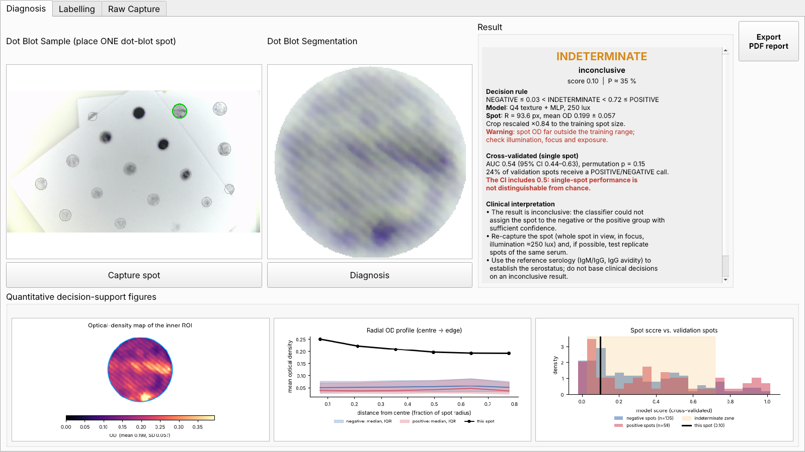

# PoCT – Toxoplasmosis Diagnosis Device (software)

Desktop application of the point-of-care (PoCT) reader for the anti-GRA7 dot-blot assay for *Toxoplasma gondii* serodiagnosis: live camera → YOLOv8-seg spot detection → automatic circular cropping → artefact-free quantification → positive / negative / indeterminate call with decision-support figures.


*Diagnosis tab (demo frame taken from the segmentation dataset, not a clinical measurement). Left: live view, the most confident detection is outlined in green. Middle: captured crop. Right: classification label. Bottom: optical-density map of the inner ROI, radial OD profile against the reference spots, and the spot score against the cross-validated validation spots.*

> **Status: research prototype.** The classifier is **not** a validated diagnostic device and must not be used for clinical decisions. Its cross-validated single-spot performance is currently **not distinguishable from chance** (see [Classifier and validation](#classifier-and-validation)); the application states this on screen.

## Credit

PoCT – Toxoplasmosis Diagnosis Device (Dec, 2026)
Dodit Suprianto
Email: Dodit.suprianto@polinema.ac.id
Affiliation:
- Department of Electrical Engineering, Politeknik Negeri Malang, Malang, Indonesia
- AIDS, Toxoplasma, Opportunistic Disease and Malaria (ATOM) Research Group, Faculty of Medicine, Universitas Brawijaya, Malang, Indonesia

## Application tabs

| Tab | Purpose |
|---|---|
| **Diagnosis** | One dot-blot spot per test. **Capture spot** freezes the frame and crops the most confident detection into the *Dot Blot Segmentation* canvas; **Diagnosis** runs acquisition QC, feature extraction and classification, shows the label in the *Result* group and draws three quantification figures. Every diagnosis is appended to `output/diagnosis/diagnosis_log.csv`. The window opens maximised and the layout follows the window size; the *Result* group scrolls horizontally and vertically so no text is clipped. **Export PDF report** (right of the Result group) writes an A4 report: captured spot, QC/geometry, the three figures, descriptive result, clinical interpretation and the cross-validated performance (example: `docs/example_report.pdf`). |
| **Labelling** | Builds the labelled crop dataset for training: the four spots of one 2×2 block are cropped (one per image quadrant) and saved as `{column}_{row}_{label}_{lux}.png` from the text boxes / combo boxes of the tab. |
| **Raw Capture** | Stores raw photographs (PNG) used to train the segmentation model. |

## Repository layout

```
Toxoplasmosis_Diagnosis_Device/
  dotblot_diagnosis_app.py     main application (PyQt5)
  config.py                    all settings (paths, camera, cropping); environment-variable overrides
  gui.py / gui.ui              Qt Designer layout (gui.py is generated from gui.ui with pyuic5)
  dotblot_features.py          QC + inner-ROI optical density + Q3/Q4 features (port of the classification notebook)
  dotblot_classifier.py        classifier class stored in the model bundle (needed to load it)
  train_diagnosis_model.py     builds model/dotblot_q4_mlp.joblib from the 250-lux crops, with full validation
  model/
    best.pt                    YOLOv8n-seg spot-detection weights used by the device
    dotblot_q4_mlp.joblib      classifier bundle (ensemble, decision rule, reference data, metrics)
    dotblot_q4_mlp_metrics.json
  dotblot_report.py            figures + PDF report (shared by the GUI and the export)
  docs/screenshot_diagnosis_tab.png, docs/example_report.pdf
  output/                      created at run time (git-ignored)
```

Sibling folders of the repository: `../Body_Case/` (SketchUp models of the enclosure), `../Dot_Blot_YOLO_Segmentation/` (segmentation training; the manuscript weights are in `yolo_results/dotblot-yolov8n-seg/weights/best.pt`), `../Dot_Blot_Model_ML_CNN/` (classification study and the dataset used for training).

## Installation

```bash
python -m venv .venv
.venv\Scripts\activate            # Linux/macOS: source .venv/bin/activate
pip install -r requirements.txt
```

`scikit-learn` has to stay at 1.7.2 to load `model/dotblot_q4_mlp.joblib`; otherwise re-create the bundle with `train_diagnosis_model.py`.

## Run

```bash
python dotblot_diagnosis_app.py                 # camera (4K requested; falls back automatically)
python dotblot_diagnosis_app.py --camera 1      # a specific camera index
python dotblot_diagnosis_app.py --image x.png   # still image instead of a camera (demo / tests)
set DOTBLOT_DEBUG=1                             # (Windows) print timing/detection/canvas diagnostics to the console
```

The first start can take several seconds (YOLO weights are loaded and the 4K camera mode is negotiated). The camera can be used by one program at a time; close other camera programs first.

### Operating conditions (the classifier assumes them)

* illumination of the enclosure ≈ **250 lux** (the model was trained on 250-lux crops);
* **one** dot-blot spot in the field of view (if several are detected, the most confident one is used);
* the whole spot visible and in focus; the crop is rescaled automatically if the spot size deviates by more than 15 % from the training crops.

## Configuration (`config.py`)

| Setting | Default | Environment variable | Meaning |
|---|---|---|---|
| `YOLO_WEIGHTS` | `model/best.pt` | `DOTBLOT_YOLO_WEIGHTS` | spot-detection weights |
| `CLASSIFIER_PATH` | `model/dotblot_q4_mlp.joblib` | `DOTBLOT_CLASSIFIER` | classifier bundle |
| `OUTPUT_DIR` | `output/` | `DOTBLOT_OUTPUT_DIR` | root of `diagnosis/`, `labelling/`, `raw_capture/` |
| `CAMERA_INDEX` / `CAMERA_INDICES` | `None` / `(0, 1, 2)` | `DOTBLOT_CAMERA` | camera index (or the indices tried in order) |
| `CAMERA_WIDTH/HEIGHT/FPS` | 3840 / 2160 / 30 | – | camera request |
| `PREVIEW_INTERVAL_MS` | 66 | – | preview timer (~15 fps) |
| `DEBUG` | `False` | `DOTBLOT_DEBUG` | console diagnostics (frame size, detections, YOLO time, canvas size, capture details) |
| `YOLO_PREDICT_KWARGS` | `{}` | – | extra arguments of `model.predict`, e.g. `{"imgsz": 1920, "conf": 0.25}` |
| `CROP_PADDING`, `SCALE_TOLERANCE` | 1.05, 0.15 | – | crop radius factor and rescaling tolerance (must match the training crops) |

## Diagnosis pipeline

1. **Detection** – YOLOv8n-seg finds the spots in the 4K frame; the circle is taken from the bounding box.
2. **Crop** – circular crop with 5 % padding and white background (identical to the training crops), converted to grayscale.
3. **Acquisition QC** – blank crop, too small mask or truncated spot → *INVALID*, re-capture (QC never uses feature values).
4. **Inner ROI** – only the concentric disk with 85 % of the equivalent radius is analysed, so that contour size/shape (a pressing/cropping artefact) cannot enter the features.
5. **Optical density** – OD = −log₁₀(I/255).
6. **Features** – Q4: rotation-invariant texture (GLCM over four directions and two distances, uniform LBP, multi-scale DoG energy); Q3 radial profile is used for the figure only.
7. **Classifier** – ensemble of 20 MLPs; decision from two thresholds taken from out-of-fold scores: NEGATIVE ≤ *lo*, POSITIVE ≥ *hi*, otherwise INDETERMINATE.

## Classifier and validation

* **Model:** Q4 texture + MLP, 250 lux; trained on membranes 2 + 3 of the study (164 valid spots, 22 sera: 8 positive / 14 negative), where both classes are on the same membrane, i.e. without the batch confound of membrane 1 (all positive).
* **Why raw (absolute) features:** a single new spot has no membrane against which features could be normalised. The study's higher AUCs used per-membrane normalisation and averaged several spots per serum.
* **Validation of exactly this deployed pipeline:** 5 × repeated serum-grouped 5-fold CV with nested hyper-parameter tuning.

| Metric (cross-validated) | Value |
|---|---|
| Spot-level AUC | 0.54 (95 % CI 0.44–0.63) |
| Serum-level AUC (mean of the replicate spots) | 0.68 (95 % CI 0.40–0.91) |
| Label-permutation test | p = 0.15 |
| Shape-only artefact control, spot AUC | 0.54 |
| Youden threshold | sensitivity 0.54, specificity 0.59 |
| Dual thresholds (lo / hi) | 0.03 / 0.72 – 24 % of validation spots receive a POSITIVE/NEGATIVE call |

Interpretation: with the present training data, one raw spot does not carry enough information to separate the classes; the application therefore labels most spots INDETERMINATE and says so on screen. The numbers are read from the model bundle, so they update when the model is re-trained. Possible routes to a usable single-spot call: on-membrane reference/cut-off spots for normalisation, local-background normalisation from the full frame, or averaging the four replicate spots.

### Re-training

```bash
python train_diagnosis_model.py            # defaults: ../Dot_Blot_Model_ML_CNN/Dataset  ->  model/dotblot_q4_mlp.joblib
python train_diagnosis_model.py --dataset <folder with Grayscale_Test 1/2/3> --lux 250 --repeats 5 --n-perm 100
```

Takes about 3–4 minutes on a CPU. Features are computed from the crops with `dotblot_features.py` (identical to the classification notebook up to 4·10⁻⁹).

## Outputs (`output/`, not tracked by git)

| File | Content |
|---|---|
| `diagnosis/<timestamp>_crop.png`, `diagnosis/diagnosis_log.csv` | captured crop and one log row per diagnosis (score, probability, label, QC, rescale factor, model build) |
| `reports/report_<timestamp>.pdf` | PDF reports (default location of the save dialog) |
| `labelling/*.png` | labelled crops for the training dataset |
| `raw_capture/*.png` | raw photographs |

## Verification status

* The Diagnosis, Labelling and Raw-capture tabs were exercised headlessly (offscreen Qt) with a still image from the segmentation dataset: detection, capture, QC, classification, figures, window resizing/maximising, the scrollable Result group and the PDF export work.
* The camera path (4K, `config.CAMERA_INDICES`) was confirmed to work on the developer's PC (Windows, Python 3.12).
* Feature extraction reproduces the classification notebook (max. absolute difference 4·10⁻⁹ on 12 crops).
* Not covered by automatic tests: operation with the physical camera and enclosure, and any clinical performance.

## License and citation

**License:** to be chosen by the authors before publication (add a `LICENSE` file; until then all rights are reserved).

**Citation:** the DOI/reference of the accompanying manuscript will be added here.

**Disclaimer.** Research prototype for the anti-GRA7 dot-blot study. It is not a validated medical device and must not be used for clinical decisions. In the current validation the single-spot AUC (0.54, 95 % CI 0.44–0.63) is not distinguishable from chance; see *Classifier and validation*.
